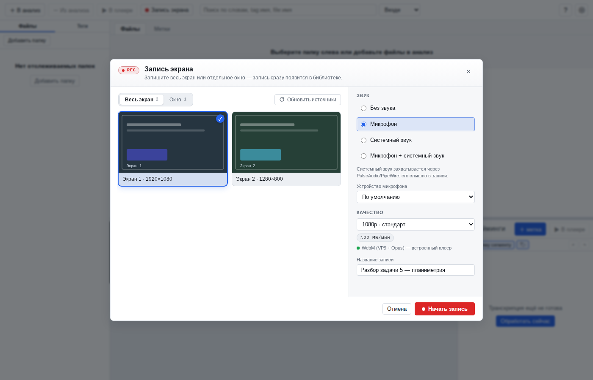
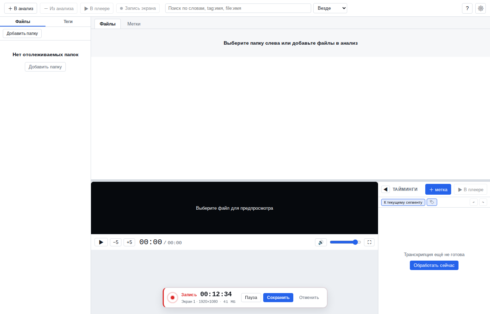

# Руководство пользователя

## Добавить папку и проиндексировать

1. Левая панель → «Файлы» → «Добавить папку» (или кнопка **＋ В анализ** в тулбаре — выбрать файлы/папку).
2. Приложение просканирует папку, определит длительность и покажет файлы в списке.
3. Отслеживаемые папки наблюдаются: новые видео появляются автоматически.

## Вид панели файлов: список и блоки

В шапке панели «Файлы» есть переключатель вида:

- **Списком** — привычная таблица с сортировкой по колонкам.
- **Блоками** — сетка карточек с превью, длительностью, статусом и счётчиком тегов. Рядом с
  переключателем появляется поле **«Блоков в ряд»**: 2…12, по умолчанию **6**.
  Выбранное число блоков применяется сразу; при узком окне карточки просто становятся мельче.

Режим и число блоков запоминаются (`localStorage`) и сохраняются после перезапуска. Выделение,
диапазонное выделение (`Shift`), мультивыбор (`Ctrl`), двойной клик, контекстное меню, перетаскивание
тегов на файл и перетаскивание файлов в панель работают одинаково в обоих видах.

## Перемещение и копирование в папку

Правый клик по файлу (в списке или в блоках) → **«Переместить в папку»** или **«Скопировать в папку»**.
Действие применяется ко всем выделенным файлам.

- В подменю показываются до **5 последних папок-назначений** — история хранится в настройках приложения
  (последняя использованная — сверху). Выбор пункта сразу выполняет операцию.
- Пункт **«Выбрать другую папку…»** открывает диалог выбора: навигация по отслеживаемым папкам,
  «↑ На уровень выше», текущий путь и кнопка «Переместить сюда»/«Скопировать сюда». Стартовая папка —
  та, где лежит первый выбранный файл.
- Перемещать и копировать можно **только внутрь отслеживаемых папок и их подкаталогов** — так файлы не
  «пропадают» из библиотеки.
- **Перемещение** сохраняет запись библиотеки: id, теги, транскрипция, сегменты, метки и превью
  остаются на месте, меняется только путь. Thumbnail-кэш переиспользуется.
- **Копирование** создаёт физическую копию и индексирует её. Так как содержимое совпадает, копия
  помечается статусом **«Дубликат»** (политика дедупликации по `sha256`) — файл можно открывать и
  смотреть, но транскрипция у копии своя (при необходимости запустите «Переобработать»).
- Если в папке назначения уже есть файл с таким именем, операция для этого файла не выполняется
  (ошибка в тосте, существующий файл не перезаписывается).
- После операции библиотека и счётчики обновляются, а папка-назначение попадает в историю.

## Транскрипция

Двойной клик по файлу → панель предпросмотра. Если транскрипции нет — «Обработать сейчас». Очередь FIFO, прогресс виден в статусе.
Модель и язык — в настройках (`small` по умолчанию, CPU INT8). Отмена — «－»/контекстное меню/статус.
Модели **не входят в установочный пакет** (M13): при первом запуске скачайте нужную модель в
«Настройки → Модели» (см. раздел ниже) или импортируйте её из файла для офлайн-установки.

## Форматы и автопревью (HEVC/MKV и др.)

Chromium/Electron не умеет декодировать HEVC (x265/H.265) и часть контейнеров, поэтому такие файлы
(например, `*.x265.HEVC.mkv`) не показывают картинку, хотя звук идёт. Приложение этого не скрывает:
при открытии оно определяет кодеки через ffprobe и, если формат несовместим:

- **remux** — если кодек видео поддерживается (H.264/VP9/AV1), файл быстро перепаковывается в MP4;
- **transcode** — если кодек не поддерживается (HEVC, MPEG-4, 10-bit H.264), видео конвертируется в H.264
  8-bit 720p (для файлов выше 720p), аудио — в AAC stereo.

На время конвертации в плеере показывается прогресс с исходным кодеком. Результат кэшируется в
`~/.local/share/VideoLessons/cache/preview/` и при следующем открытии используется мгновенно.
Кэш можно очистить в «Настройки → Кэш превью», полностью — удалив каталог `cache/preview`.

## Внешний плеер (mpv/VLC) и синхронизация

Для форматов, которые не декодирует встроенный Chromium-плеер (HEVC/10-bit/MKV и др.), можно смотреть
во **внешнем системном плеере** — без конвертации и без расхода диска:

- **Кнопка «▶ В плеере»** — в тулбаре, в шапке панели таймингов, поверх видео, а также `Ctrl+Enter`.
- **Диалог запуска:** выбрать плеер (mpv/VLC/системный), начать с начала / с текущей позиции / с метки,
  передать метки (главы и субтитры) и «запомнить выбор».
- **Пульт в приложении (mpv):** видео играет в отдельном окне mpv, а в приложении остаются живой таймлайн,
  тайминги и метки — позиция, пауза, перемотка и громкость синхронизированы через mpv IPC.
  Клик по сегменту/метке перематывает mpv; `Ctrl+M` создаёт метку на текущей позиции mpv.
- **VLC / системный плеер:** запуск с нужного времени работает, live-синхронизации нет (честно помечено в пульте).
- **Метки в плеере:** по желанию передаются главами (`--chapters-file`) и субтитрами (`.ass` с цветом/тегами).
- **Политика** в настройках: «Спрашивать» / «Всегда внешний плеер» / «Всегда конвертировать».
  При «Спрашивать» для несовместимого файла показывается выбор: открыть снаружи или конвертировать здесь.
- Настройки → «Внешний плеер»: выбор плеера, путь к бинарнику (если не в PATH), политика, передача меток,
  индикация «найден/не найден». По умолчанию — mpv (единственный с полной синхронизацией).

## Запись экрана/окна

Кнопка **⏺ Запись** (aria-label «Запись экрана») в тулбаре открывает диалог записи. Запись сохраняется
в библиотеку как обычное видео и сразу играется встроенным плеером — внешний плеер не нужен.

*Диалог: выбор экрана/окна, звука и качества.*

*Панель активной записи: таймер, пауза, сохранить, отменить.*

1. **Источник.** Вкладки «Весь экран» / «Окно»: выберите карточку с миниатюрой; кнопка обновления
   перечитывает список (экраны и окна меняются). В браузере без Electron запись недоступна — диалог
   объяснит причину.
2. **Звук.** Радиогруппа «Без звука / Микрофон / Системный звук / Микрофон + системный звук» и выбор
   устройства микрофона (если несколько).
   - **Микрофон** пишется прямо в WebM — синхронизация точная.
   - **Системный звук** (только Linux с PulseAudio/PipeWire) захватывается с monitor-устройства
     звуковой карты и подмешивается при сохранении. Нужны утилиты `pactl` и `parec`
     (пакет `pulseaudio-utils`) либо системный ffmpeg с libpulse; поставляемый в приложении статический
     ffmpeg не содержит pulse-демаксера, поэтому в релизе используется `parec`. Недоступная опция
     disabled с указанием причины.
3. **Качество** (оценка размера показывается в диалоге):
   - `low` — 720p, ≈1,5 Мбит/с, **≈11 МБ/мин**;
   - `standard` — 1080p, ≈3 Мбит/с, **≈22 МБ/мин**;
   - `high` — исходное разрешение, ≈6 Мбит/с, **≈45 МБ/мин**.
   Аудио — Opus 96–128 кбит/с. Формат — **WebM (VP9 + Opus)**; при отсутствии VP9 используется VP8.
4. **Название** (необязательно) — иначе запись получит имя «Запись экрана ДД.ММ.ГГГГ ЧЧ:ММ» (или «Запись окна …»).
5. **Старт.** После «Начать запись» диалог закрывается, внизу по центру появляется панель записи:
   пульсирующая красная точка, статус «Запись»/«Пауза», таймер `ЧЧ:ММ:СС`, имя источника, размер и кнопки
   **«Пауза/Продолжить»**, **«Сохранить»**, **«Отменить»** (с подтверждением). Время на паузе не входит
   в длительность записи. В основной панели видео вместо плеера показывается **живой предпросмотр**
   записываемого экрана/окна (звук предпросмотра выключен, пауза картинку экрана не замораживает);
   после сохранения панель возвращается к обычному плееру.
6. **Сохранение.** По «Сохранить» запись финализируется (ffmpeg) и появляется в библиотеке; toast
   «Запись сохранена: <название>» содержит действие **«Обработать»** — поставить запись в очередь
   транскрипции. Файл лежит в `$VL_DATA_DIR/recordings/rec-*.webm`
   (по умолчанию `~/.local/share/VideoLessons/recordings/`).
7. **Просмотр.** Двойной клик по записи в списке — встроенный плеер; доступны панель таймингов, метки,
   теги и поиск, как у обычного видео. Внешний плеер для WebM VP9+Opus не требуется.

Ограничения:

- системный звук — только Linux (PulseAudio/PipeWire; нужны `pactl` и `parec` из `pulseaudio-utils` либо
  системный ffmpeg с libpulse); на Windows/macOS доступен только микрофон;
- Wayland: список окон зависит от xdg-desktop-portal/XWayland; если источник недоступен, UI покажет ошибку;
- синхронизация системного звука с видео может отличаться на ~0,1–0,3 с (микрофон синхронизирован точно);
- при аварийном завершении приложения незаконченная запись теряется (временные файлы удаляются при
  следующем старте), при закрытии окна во время записи показывается предупреждение;
- автоматическая транскрипция записи не запускается — используйте действие «Обработать» в тосте.

## Поиск

- Поле поиска в тулбаре: обычные слова, фразы в кавычках, `AND`/`OR`/`NOT`.
- `tag:имя` — поиск по тегу, `file:имя` — по имени файла.
- Переключатель области: Везде / Файлы / Сегменты / **Метки**.
- Режимы поиска (в шапке панели результатов): **Обычный** / **Семантика** / **Гибрид** — см. следующий раздел.
- Панель результатов открывается **под вкладками «Файлы/Метки»** и заменяет список: шапка с режимами
  и статусом индексации закреплена, сами результаты прокручиваются внутри панели. Клик по вкладке
  «Файлы»/«Метки» или «×» закрывает поиск и возвращает список.
- Клик по результату-сегменту или метке открывает видео на нужном таймкоде.

## Семантический поиск (M12)

Кроме «обычного» лексического поиска (точные слова) приложение умеет искать **по смыслу** — с учётом
русской морфологии и синонимов. Семантика работает по **сегментам транскрибации**.

- **Режимы** (переключатель «Обычный / Семантика / Гибрид» в шапке результатов):
  - **Обычный** — FTS5, как раньше: точные словоформы, `AND/OR/NOT`, фразы;
  - **Семантика** — только векторный поиск по сегментам;
  - **Гибрид** — FTS + вектора (Reciprocal Rank Fusion); режим по умолчанию.
- **Русский язык — приоритет.** Модель многоязычная и поисковая (retrieval): запрос «как найти
  производную сложной функции» находит сегмент «Производная сложной функции…», хотя точных словоформ
  в тексте нет (лексический поиск в этом случае даёт 0 результатов).
- **Модель:** `intfloat/multilingual-e5-small` в ONNX int8 (~130 МБ, 384-мерные векторы), скачивается
  один раз: `bash scripts/fetch-embed-model.sh`. После этого всё работает **офлайн**. Без модели
  (или без `onnxruntime`) приложение продолжает работать, но только лексически — режимы
  «Семантика/Гибрид» отключены с пояснением.
- **Индексация** — автоматическая: сразу после транскрипции каждого видео, плюс фоновая доиндексация
  старых видео при старте. Статус виден в панели: «Проиндексировано: X/Y» или «Индексируется: X/Y».
  Кнопка **«Переиндексировать»** запускает полную переиндексацию (например, после смены модели).
- **Область:** семантика применяется к «Везде» и «Сегменты»; для областей «Файлы» и «Метки» поиск
  остаётся обычным (об этом подсказывает строка под переключателем).
- **Ограничения:** векторный поиск — brute-force косинус по матрице в памяти (быстро до ~10⁵ сегментов,
  дальше потребуется sqlite-vec); ~1,5 КБ БД на сегмент; фильтры по тегам/видео/`file:`/`tag:` работают.

Скриншот панели: [семантический поиск](screens/search-results.png).

## Модели: загрузка, импорт, офлайн-режим (M13)

Все модели управляются в **«Настройки → Модели»**; в установочный пакет они не входят.

- **Распознавание речи:** Whisper `tiny`/`base`/`small`/`medium` (CTranslate2). `small` помечен как
  рекомендованный. Активная модель — `whisper_model` в настройках.
- **Семантический поиск:** `multilingual-e5-small` (ONNX int8).
- **Саммари:** две модели, можно установить **обе одновременно**:
  - `KoarAI/LFM2.5-350M-Thinking` — значок **«Рекомендованная»**, используется по умолчанию;
  - `Qwen2.5-0.5B-Instruct` — значок **«Альтернатива»** (лучше русский, без режима рассуждений).
  Активная модель выбирается в «Настройки → Саммари» и переключается без повторной загрузки.
- **Загрузка:** «Скачать» → прогресс, докачка при обрыве, отмена; размеры видны до скачивания.
- **Импорт без сети (air-gapped):** «Импорт из файла…» → папка с файлами модели или архив
  `.zip`/`.tar.gz`; файлы проверяются по SHA-256 из реестра.
- **Зеркало:** «Зеркало моделей (URL)» — если HuggingFace недоступен, укажите зеркало.
- **Офлайн-режим:** галочка «Офлайн-режим» (или `VL_OFFLINE=1`) запрещает сеть; импорт остаётся доступным.
- **Старые установки:** модели, встроенные в `resources/models`, распознаются как «Встроена» (удалить их нельзя).
- Сеть используется **только** при явном нажатии «Скачать»; фоновых сетевых запросов нет.

## Саммари и шкала детализации (M14)

В панели «Тайминги» справа есть **вертикальная шкала детализации** (лупа «+» сверху, лупа «−» снизу).
Саммари строится иерархически: сначала модель анализирует **весь текст** и выделяет смысловые блоки
(если текст не влезает в контекст — по частям, но с общим верхнеуровневым саммари), затем каждый блок
рекурсивно делится на подблоки по смыслу — вплоть до отдельных строк транскрибации.

- **Уровень 0 «Дословно»** — обычные построчные сегменты (как раньше).
- **Уровни 1..N** — блоки саммари разной степени детализации: от подробных подблоков до корневого
  обзора «о чём видео». **Число уровней у каждого видео своё** — шкала рисуется по фактической глубине
  дерева этого видео (может быть 2, 3, 5…), поэтому она не фиксированная.
- Метки уровней — «Подробно», «Темы», «Обзор» и промежуточные «Средне/Кратко» (по фактической структуре).
- Перетаскивайте ползунок мышью/колесом или используйте `↑`/`↓`, `PageUp`/`PageDown`, `Home` (0) / `End`
  (максимальное сжатие); уровень запоминается и клампится, если у нового видео глубина меньше.
- Клик по блоку → seek на его таймкод; блоки имеют заголовки и ключевые термины; активный блок
  подсвечивается и автопрокручивается.
- Саммари генерируется локально на CPU (llama.cpp) в фоне: «Анализ всего текста…» → «Разбиение на
  смысловые блоки: X/Y» → «Подготовка саммари…». Пока дерева нет — «Сгенерировать»; модель не
  установлена — «Скачать модель»; ошибка — «Повторить»; после переобработки — «Перегенерировать».
- На уровне 0 всё работает как раньше: метки, мультивыбор, автопрокрутка; метки видны и в режиме саммари.

### Если саммари не появилось после транскрипции

- Проверьте «Настройки → Саммари»: галочка **«Автоматически»** должна быть включена. При выключенной
  автогенерации саммари не запускается само — это ожидаемо.
- Ручной запуск: перетащите ползунок шкалы вниз на позицию **«Саммари»** (появляется, пока дерева ещё нет)
  и нажмите **«Сгенерировать»** (или генерация начнётся сразу после переключения уровня).
- Если показано «Модель не установлена» — скачайте LFM2.5-350M-Thinking/Qwen2.5-0.5B в
  «Настройки → Модели» и повторите.
- Прогресс виден в панели: «Анализ всего текста…» → «Разбиение на смысловые блоки: X/Y» →
  «Подготовка саммари…». Уровень 0 (дословные сегменты) доступен всегда.

## Горячие клавиши

| Клавиши | Действие |
|---|---|
| `Ctrl+F` | фокус в поиск |
| `Ctrl+O` | добавить файлы |
| `Ctrl+M` | новая метка |
| `Shift+I` / `Shift+O` | начало/конец метки в позиции плеера |
| `Space` | play/pause |
| `←`/`→` | ±5 с |
| `J`/`K`/`L` | −10 с / play-pause / +10 с |
| `Delete` | удалить выбранную метку |
| `Ctrl+Z` / `Ctrl+Shift+Z` | отменить / повторить |
| `F1` | окно «О клавишах» |
| `Esc` | закрыть/очистить |

## Где лежат данные и логи

`~/.local/share/VideoLessons/`: `library.db`, `logs/backend.log`, `cache/thumbs/`, `tmp/`,
`recordings/` (записи экрана/окна, WebM VP9+Opus); незаконченные записи — `tmp/recordings/`.
Эмбеддинги семантического поиска хранятся в `library.db` (таблица `segment_embeddings`, ~1,5 КБ на сегмент).
Модели (M13) — в `~/.local/share/VideoLessons/models/` (переопределяется `VL_MODELS_DIR`):
`faster-whisper-*`, `multilingual-e5-small-onnx/`, `lfm2.5-350m-thinking/`, `qwen2.5-0.5b-instruct/`;
рядом с каждой моделью — `.installed.json` с версией/контрольными суммами. Установка/удаление — в
«Настройки → Модели». Старые встроенные модели из `resources/models` по-прежнему читаются, но только на чтение.
Саммари хранится в `library.db` (`summary_chunks`, `summary_levels`; кэш раздельный для каждой модели).
